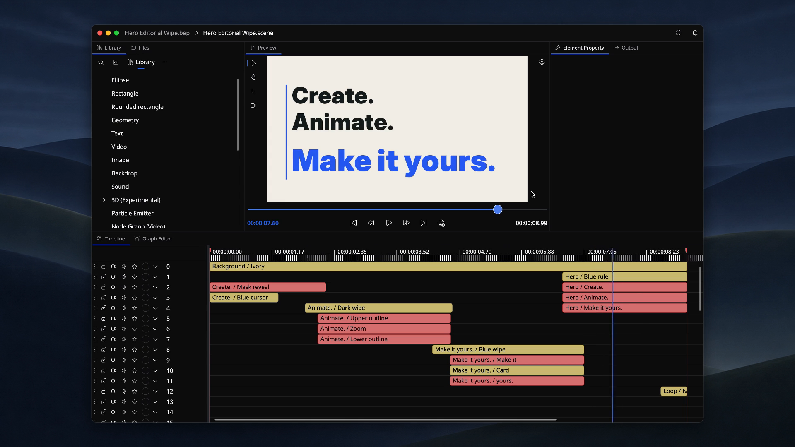

# 🎬 Beutl

[English](README.md) / __Japanese__


[](https://github.com/b-editor/beutl/actions/workflows/daily-build.yml)
[](https://discord.gg/Bm3pnVc928)

**創ろう。動かそう。あなたの映像を。**

Beutl（ビュートル）は、**Windows・macOS・Linux** で使える無料・オープンソースの動画編集・合成ソフトウェアです。キーフレーム、ノードグラフ、エフェクト、シェーダを使って、映像・図形・テキスト・音を組み合わせられます。

[ダウンロード](https://beutl.beditor.net/ja#download) · [公式サイト](https://beutl.beditor.net/ja) · [ドキュメント](https://docs.beutl.beditor.net/ja) · [拡張機能](https://beutl.beditor.net/ja/store)



_Beutlで制作したタイポグラフィ。[編集デモを見る](https://beutl.beditor.net/ja)。画像は開発中のバージョンです。_

## 📖 機能

### タイムライン & 合成

映像・図形・テキスト・音を、それぞれレイヤーとしてタイムラインに並べて編集できます。シーンをネストして複雑な合成を整理し、非破壊編集とUndoで試行錯誤できます。

### ノードグラフ

図形やエフェクト、乱数、スイッチなどのノードをつないで、手続き的に表現を組み立てられます。ひとつの値を変えると、つながった処理全体に反映されます。

### キーフレーム & イージング

フェードやスライドからキネティックタイポグラフィまで、オブジェクトごとにアニメーションを付けられます。Back・Bounce・Elasticなどのイージングやスプライン曲線で、動きの緩急を調整できます。

### エフェクト・シェーダ・スクリプト

ぼかし、シャドウ、LUT、クロマキー、ピクセルソート、ディスプレイスメントマップなどを重ねて適用できます。SKSL・GLSLのシェーダやC#スクリプトで、独自のエフェクトを作ることもできます。

### オーディオ & ビジュアライザー

EQ、コンプレッサー、リミッター、ディレイでBGMや効果音をミックスできます。波形・スペクトラム・スペクトログラムのビジュアライザーで、音を映像として表現することもできます。

### テキスト & タイポグラフィ

太字・斜体・サイズ・色・字間をタグで指定できます。字幕やテロップを作ったり、テキストを文字ごとに分割してキーフレームで動かしたりできます。

### GPUレンダリング & 書き出し

VulkanベースのGPU描画に対応し、macOSではMoltenVK経由、GPUのない環境ではソフトウェアで描画します。プレビューは縮小スケールで確認し、書き出しにはスーパーサンプリングを使えます。MP4・MOV・MKV・WebMなどの形式に出力できます。

### そのほかの制作ツール

- **図形とブラシ:** ベジェ曲線、円弧、グラデーション、画像・タイル・ノイズブラシ。
- **パーティクル:** エミッターで炎・煙・きらめきなどの粒子表現を生成。
- **カラーグレーディング:** トーンカーブ、`.cube` LUT、HDR・広色域のカラーマネジメント。
- **式による制御:** 他のプロパティを参照して、パラメータを計算・連動。
- **3Dシーン（実験的）:** カメラ、ライティング、メッシュ、PBRマテリアルを使い、2D合成に3D要素を追加。

### 拡張機能

[拡張機能ストア](https://beutl.beditor.net/ja/store)からエフェクト、オブジェクト、コーデック、UIなどを追加できます。自分で拡張機能を開発し、公開することもできます。

### バージョン管理

プロジェクトの編集履歴を Git で管理し、Beutl の中から過去のバージョンへの復元、試行用ブランチの作成、リモートリポジトリへのバックアップができます。

## 📥 インストール

[公式サイト](https://beutl.beditor.net/ja#download)でお使いのOS向けのファイルを選び、[インストールガイド](https://docs.beutl.beditor.net/ja/get-started/install)に沿ってセットアップしてください。リリースノートと過去のバージョンは[GitHub Releases](https://github.com/b-editor/beutl/releases)から確認できます。

## 開発

初回チェックアウト時は、先に `git submodule update --init --recursive` でGitサブモジュールを初期化してください。

リポジトリのルートで、付属のスクリプトを実行します。Nukeのグローバルツールのインストールは不要です。

macOS/Linux:

```sh
./build.sh dev
```

Windows (PowerShell):

```powershell
.\build.ps1 dev
```

`src/Beutl` をDebug構成で実行します。TFMはWindowsでは `net10.0-windows`、macOS/Linuxでは `net10.0` を自動選択します。Nukeのグローバルツールをインストール済みの場合は、`nuke dev` も使用できます。

[古いバージョン（BEditor）のソースコード](https://github.com/b-editor/beutl/tree/old/develop)

## License

このプロジェクトは **MIT License** ([LICENSE](https://github.com/b-editor/beutl/blob/main/LICENSE)) の下でライセンスされています。

**Beutl.FFmpegWorker** はGPLライセンスのFFmpegをリンクする独立した実行ファイルであり、**GNU General Public License v3** ([LICENSE.GPL](https://github.com/b-editor/beutl/blob/main/LICENSE.GPL)) の下で配布されます。メインアプリケーションとはIPCを介して通信する別プロセスとして動作するため、GPLはコードベースの他の部分には適用されません。

## Patrons

- ozero
- [darthaunty1](https://www.patreon.com/user/creators?u=89848438)
- [calloc134](https://github.com/calloc134)
- [Bony_Chops](https://github.com/BonyChops)
- [Hayashi Tomonari](https://www.patreon.com/user/creators?u=62872137)
