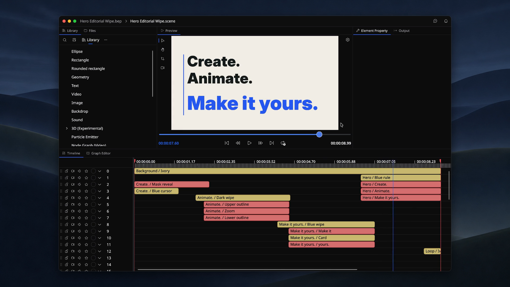

# 🎬 Beutl

[English](README.md) / [Japanese](README.ja.md) / __Türkçe__


[](https://github.com/b-editor/beutl/actions/workflows/daily-build.yml)
[](https://discord.gg/Bm3pnVc928)

**Üret. Canlandır. Kendine özgü kıl.**

Beutl (/bjútəl/ olarak okunur), **Windows, macOS ve Linux** için ücretsiz ve açık kaynaklı bir video düzenleme ve birleştirme (compositing) yazılımıdır. Video, şekil, metin ve sesi anahtar kareler (keyframe), düğüm grafikleri, efektler ve gölgelendiricilerle (shader) bir araya getirin.

[İndir](https://beutl.beditor.net/en#download) · [Web Sitesi](https://beutl.beditor.net/en) · [Belgeler](https://docs.beutl.beditor.net) · [Eklentiler](https://beutl.beditor.net/en/store)

https://github.com/user-attachments/assets/fb259985-06c1-48a4-8e35-baf43ec21ea9

_Beutl düzenleyicisi: kırpma geçişi, anahtar kareler, simetrik spline tutamaçları, yumuşatılmış yakınlaştırma ve metin hizalamasıyla hazırlanmış bir tipografik animasyonun inceltilmesi ve bitmiş sonucun oynatılması._

## 📖 Özellikler



_Beutl içinde bir tipografik animasyon. Görsel bir geliştirme sürümünden alınmıştır._

### Zaman Çizelgesi ve Birleştirme

Videoyu, şekilleri, metinleri ve sesi zaman çizelgesinde ayrı katmanlar olarak düzenleyin. Karmaşık bileşimleri düzenli tutmak için sahneleri iç içe yerleştirin ve tahribatsız düzenleme ile geri alma özgürlüğüyle denemeler yapın.

### Düğüm Grafikleri

Prosedürel görseller oluşturmak için şekilleri, efektleri, rastgele değerleri ve anahtarları birbirine bağlayın. Bir değeri değiştirin ve bağlı düğümlerin bu değişikliği tüm bileşiminize taşımasını izleyin.

### Anahtar Kareler ve Yumuşatma (Easing)

Kararmalardan ve kaydırmalardan kinetik tipografiye kadar tekil nesneleri canlandırın. Back, Bounce ve Elastic gibi yumuşatma işlevleriyle zamanlamayı şekillendirin veya spline eğrileriyle hareketi ince ayarlayın.

### Efektler, Gölgelendiriciler ve Betikler

Bulanıklık, gölgeler, LUT'lar, yeşil perde (chroma key), piksel sıralama ve yer değiştirme haritaları gibi yerleşik efektleri üst üste ekleyin. Özel bir efekte ihtiyaç duyduğunuzda SKSL veya GLSL gölgelendiricileri ve C# betikleri yazın.

### Ses ve Görselleştiriciler

EQ, kompresör, sınırlayıcı ve gecikme efektleriyle müzik ve ses efektlerini miksleyin. Dalga formu, spektrum ve spektrogram görselleştiricileriyle sesi görsele dönüştürün.

### Metin ve Tipografi

Metinleri kalınlık, italik, boyut, renk ve harf aralığı etiketleriyle biçimlendirin. Altyazılar oluşturun veya metni tek tek karakterlere bölüp anahtar karelerle canlandırın.

### GPU İşleme ve Dışa Aktarma

Vulkan tabanlı GPU işlemeyi kullanın; macOS'ta MoltenVK ve GPU bulunmadığında yazılım yedeği devrededir. Küçültülmüş ön izlemelerle akıcı çalışın, ardından süper örnekleme ile dışa aktarın. Desteklenen çıktı biçimleri arasında MP4, MOV, MKV ve WebM bulunur.

### Daha Fazla Yaratıcı Araç

- **Şekiller ve fırçalar:** Bézier eğrileri, yaylar, gradyanlar ile görsel, karo ve gürültü fırçaları.
- **Parçacıklar:** Ateş, duman ve kıvılcım gibi efektler için yayıcılar.
- **Renk düzenleme:** Ton eğrileri, `.cube` LUT'lar ve HDR / geniş renk gamı yönetimi.
- **İfadeler (Expressions):** Özellikleri birbirine bağlayın ve parametreleri diğer değerlerden hesaplayın.
- **3B sahneler (deneysel):** 2B bileşimleri kameralar, ışıklandırma, ağlar (mesh) ve PBR materyalleriyle birleştirin.

### Yapay Zekâ Ajanları

Bir yapay zekâ ajanı, siz izlerken açık projenizde doğrudan kurgu yapabilir. Oluşturduğu her şey zaman çizelgesine sıradan katmanlar, anahtar kareler ve efektler olarak düşer; böylece istediğiniz noktada kontrolü devralıp devam edebilirsiniz. Ajanın düzenlemeleri ve sizinkiler tek bir geri alma geçmişini paylaşır.

https://github.com/user-attachments/assets/30d412f5-4e6e-405b-988d-342a406f595a

_Beutl'un Terminal sekmesinde kayıtlı ajan düzenlemelerini hızlandırılmış olarak oynatan Claude Code. Ajan kendi çıktısında bulduğu bir kusuru düzeltir, ardından aynı proje Grafik Düzenleyicisi'nde elle inceltilir._

**Settings → AI Agents** altında istemcinizi seçin, **MCP server** seçeneğini etkinleştirin ve `beutl-agent`'ı kaydetmek için **Install** düğmesine tıklayın. MCP üzerinden Skills destekleyen istemciler paket içi yetenekleri bu bağlantı üzerinden keşfeder. `get_started` aracı kaynak URI'larını sağlar ve **Skills** seçeneği yerel kopyaları kurar. [MCP Skills uzantısı](https://github.com/modelcontextprotocol/ext-skills)

### Eklentiler

[Eklenti mağazası](https://beutl.beditor.net/en/store) aracılığıyla efektler, nesneler, kodekler ve arayüz öğeleri ekleyin. Kendi eklentilerinizi geliştirip yayınlayabilirsiniz.

### Sürüm Kontrolü

Bir projenin düzenleme geçmişini Git ile takip edin, önceki sürümlere dönün, deneysel dallar oluşturun ve çalışmanızı doğrudan Beutl içinden uzak bir depoya yedekleyin.

## 📥 Kurulum

[Web sitesinden](https://beutl.beditor.net/en#download) işletim sisteminize uygun indirmeyi seçin ve [kurulum kılavuzunu](https://docs.beutl.beditor.net/get-started/install) izleyin. Sürüm notları ve önceki sürümler [GitHub Releases](https://github.com/b-editor/beutl/releases) sayfasında yer alır.

## Geliştirme

Global Nuke aracına gerek duymadan depo kök dizinindeki betikleri kullanarak uygulamayı çalıştırın.

macOS/Linux:

```sh
./build.sh dev
```

Windows (PowerShell):

```powershell
.\build.ps1 dev
```

Bu komut `src/Beutl` projesini Debug yapılandırmasında çalıştırır; Windows'ta `net11.0-windows`, macOS/Linux'ta `net11.0` hedefini otomatik seçer. Global Nuke aracı zaten kuruluysa `nuke dev` komutunu da kullanabilirsiniz.

[Eski sürümün kaynak kodu (BEditor)](https://github.com/b-editor/beutl/tree/old/develop)

## Lisans

Bu proje **MIT Lisansı** ([LICENSE](https://github.com/b-editor/beutl/blob/main/LICENSE)) altında lisanslanmıştır.

**Beutl.FFmpegWorker**, GPL lisanslı FFmpeg ile bağlanan ayrı bir çalıştırılabilir dosyadır ve **GNU General Public License v3** ([LICENSE.GPL](https://github.com/b-editor/beutl/blob/main/LICENSE.GPL)) altında dağıtılır. Bağımsız bir süreç olarak çalışır ve ana uygulamayla IPC üzerinden haberleşir; dolayısıyla GPL kod tabanının geri kalanına uygulanmaz.

## Destekçiler

- ozero
- [darthaunty1](https://www.patreon.com/user/creators?u=89848438)
- [calloc134](https://github.com/calloc134)
- [Bony_Chops](https://github.com/BonyChops)
- [Hayashi Tomonari](https://www.patreon.com/user/creators?u=62872137)
